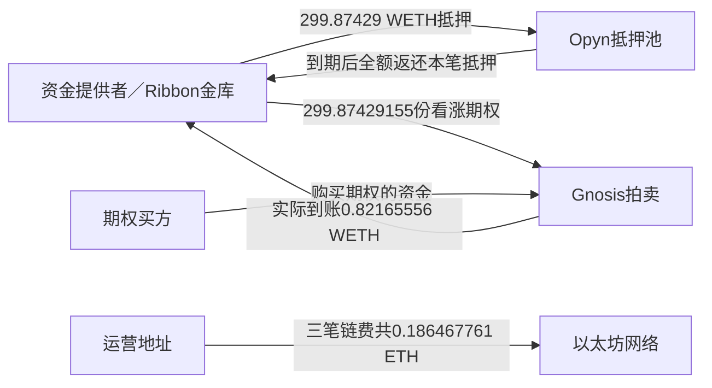

# Ribbon首轮真实交易：钱从哪里来，谁付了费用

复核日期：北京时间2026-10-17。**已有现金盈利案例中的一轮交易，现在可以按原始回执讲清：金库交出抵押、售出看涨期权，拍卖合约实际支付权利金，到期后该笔抵押全额返还。收入来自买方购买期权承担的对价，不是证明了AI预测优势。**

这是既有固定12轮中的时间首轮 sample_index=1，未按输赢挑选。三笔原始成功回执由公开Routescan以太坊索引于UTC2026-10-16取得，本轮复核保存原件及哈希，新增公开读取0；没有重新运行历史解码脚本、模型、回测或交易。不是新增一笔已经核过的盈利，也不重算已闭合的个人20ETH现金桥。

## 一笔完整的实际交易

WETH是以太坊上用于合约的封装ETH；这里按WETH原始数量记账，不假设已经兑换成美元。下表时间为UTC。

| 环节 | 实际发生 |
|---|---|
| 2021-09-17 11:21:12，锁抵押并发行期权 | Ribbon金库向Opyn抵押池交入299.874291555001194782 WETH；铸造并送拍299.87429155份期权 |
| 合约是什么 | WETH标的及抵押、USDC行权计价的看涨期权；行权价4200 USDC；2021-09-24 08:00到期；auction53 |
| 2021-09-17 12:25:29，拍卖结算 | Gnosis拍卖合约实际向金库转入0.821655558862259317 WETH；出售数量与送拍数量相同 |
| 2021-09-24 10:14:44，平仓结算 | Opyn抵押池返还同量299.874291555001194782 WETH；该short已观察到的抵押损失为0 |

原始交易：[开仓](https://etherscan.io/tx/0xca8d6fb678e7f25db3b36005a6131cf09dac5878df30295b376c8b714cc07984)、[拍卖款到账](https://etherscan.io/tx/0x7235cc6016faa7cfbc009afa825a464db726c1ce3ab3039086b7eee2ab70d9cf)、[抵押返还与平仓](https://etherscan.io/tx/0xe2c7567d8af7ec0e9dd6e7ecb821e2b56d915b7a646b42873562d0f689faca8a)。链接按已保存回执交易hash提供，本轮未刷新浏览器页面；[本地独立逐字段核验](</Volumes/EXTERNAL/亚力克斯 /运行验证-20261015/evidence/ribbon-completed-option-round-mechanism-20261017/protocol/selected-completed-round-original-review.json>)绑定16项原件。

图中的“买方”是经济角色。原件直接确认的付款者是拍卖合约，不把它当自然人或最终持有人；竞买者最终领取/退款不在三笔回执内。无需先查清买方的私人身份，才能承认金库已收权利金。

## 它凭什么收到这笔钱

买方付钱换取看涨期权的权利；金库承担相应的到期赔付义务。这轮实际抵押全回，因此观察到的期权抵押损失为零，收到的权利金构成金库的现金收入来源。

这并不是无风险利息。若期权产生应赔付金额，卖方可能损失部分抵押；即便期权赔付为零，ETH本身的美元价值仍可能下跌。**“ETH数量增加”与“持有ETH后美元财富增加”需要分别核算。** 三笔回执未取得精确到期预言机价格，本轮不凭行情印象填数，也不推断所有期权持有人的兑付过程或凭证均已销毁。

历史执行价及部分输入已在前阶段核过：事前源码、公开预言机读数与上游私人生成规则是不同对象。当前一轮现金说明无需重新生成私人模型；它也不证明该模型比市场更准，更不说明XTX私人策略已被复制。

## 费用由谁付：三种账分开

| 实际记录 | 金额 | 归属与解释 |
|---|---:|---|
| 金库收到本轮拍卖款 | 0.821655558862259317 WETH | 全金库金额，不能全部记给20ETH投资人 |
| 开仓交易链费 | 0.042024495 ETH | 运营发送地址支付 |
| 拍卖结算链费 | 0.009001785 ETH | 同一运营发送地址支付 |
| 平仓结算链费 | 0.135441481 ETH | 同一运营发送地址支付 |
| 三笔链费合计 | 0.186467761 ETH | 只涵盖三笔，不冒充全部经营成本 |
| 开仓roll同时支付的此前轮次费用 | 0.116280283734465449 ETH | 先前轮次收费；不能再从新权利金或已扣费个人现金重复扣除 |

链费均据成功回执gasUsed×effectiveGasPrice原量核得，付款地址为0xa4290c9eae274c7a8fbc57a1e68adc3e95e7c67e。金库、抵押池、拍卖和费用接收地址逐项记录在JSON，不猜其自然人身份或同一控制人。

本轮观察到的额外拍卖期权币费为0，依据是实际送拍数量与出售数量及转账，并结合保存源码中额外拍卖币收费方式；没有把源码默认参数当成已读取的历史存储。未取得的全运营成本单列，不将其新增为否认上述已观察现金的门槛。

两个**现金金额比**帮助理解规模：本轮权利金约为锁定抵押的0.274%；三笔运营链费约为本轮权利金的22.69%。[计算依据](</Volumes/EXTERNAL/亚力克斯 /运行验证-20261015/evidence/ribbon-completed-option-round-mechanism-20261017/root/observed-historical-amount-ratios.json>)只比较已发生金额，**不是投资回报率、年化收益、小本金模拟或未来费用估计**。金库收款与运营者付费不能合并成某个投资人的账户余额。

此前20ETH投资人在已核期间的+0.286308964405035226 ETH现金差额继续成立；其中相关费用已经按原方案处理，本轮不扣第二次。它覆盖多轮、部分退出和份额记账，不能用这一轮的全金库权利金替换。[既有个人现金核验报告](</Volumes/EXTERNAL/亚力克斯 /运行验证-20261015/Ribbon20ETH原始要求复审-已证明的赚钱事实与独立复刻缺口-20261017.md>)保留范围。

## 个人可以复制什么，缺少什么会怎样

| 环节 | 可以借鉴 | 缺少该环节的后果 |
|---|---|---|
| 定义自己卖出的权利和赔付义务 | 合约单位、到期日、抵押、结算方式逐项核 | 收错权利金、算错赔付或误判最大风险 |
| 聚合资金、按规则卖出有抵押期权 | 机制公开；个人也可研究较小单位产品 | 资金小而固定成本高时，优势可能被成本吞掉 |
| 对手方成交 | 要有买方实际付款原账 | 挂单或模型标价不能当收入 |
| 成交后核账 | 对本金、权利金、赔付、费用和主体分别记账 | 把收到的钱、返还的本金和盈利混淆 |
| 判断风险价格是否有持续优势 | 需要跨时期、含亏损的费后证据 | 这轮成功不能保证下一轮或更大资金仍盈利 |

2021年这轮Opyn合约与2026年已核OKX线性0.01ETH/张不是同一产品。可用小单位提示未来成本研究有意义，不能把交易所单位套进旧oToken原量，或声称现在已可按同条件复刻。也没有将链上2021年gas直接当今天费用。

**当前结论：赚钱机制已经有真实交易支撑，个人可复制的核心是“理解并有抵押地承接期权风险，严格核成交和成本”。尚未证明的是在个人当前可用条件下，收到的风险补偿是否持续足够。** 这一环节不是已有价格预测优势的替代证明。

## 下一步只查一件事

核**当前OKX美元保证金线性期权的小额成本结构**：公开普通等级费率按什么基数计算、有无最低收费/权利金上限、开平与交割各收什么，是否和币本位费用不同。只读官方条款；不是再查已收口的盈立套餐，也不要求账号、个人凭证或真实下单。不把公开费率分支写成用户个人适用费用。

这将判断“每张0.01ETH的小单位能否在成本上用于后续验证”，不能单凭便宜认定盈利。下一阶段仍不执行模型、回测、成交模拟或交易。当前原轮资料已足以解释其现金来源，不再为同一轮扩查全部买方或预言机价格。

本轮新增联网、付款、账户/凭证读取、源码/SDK/ABI/EVM执行、模型、回测、定价或成交模拟、真实交易、外发和自动化均0；仅自行被动读取JSON字段、日志及整数/比值核算。所有新文件是后续所需证据，保留。实际model/effort为UNKNOWN，沿用同一Owner，周用量71%按串行执行。旧FAILED、AAPL、Deribit和既有自动化均保留。财富目标未完成。
